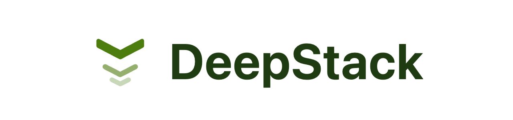

<div align="center">

<picture>
  <source media="(prefers-color-scheme: dark)" srcset="docs/wordmark-dark.png">
  
</picture>

**The most convenient way to manage many Claude Code sessions at once.**

The ideal UI for prompt engineers.

</div>

<br>

Every session sits in a live stack on the left, the one you're working in is big on
the right, and the moment you send a prompt DeepStack moves you to the next session
that's ready for you.

```sh
git clone https://github.com/lukeprofits/DeepStack && cd DeepStack && npm install && npm start
```

That builds it and opens it in a browser tab at `http://127.0.0.1:4777`. Your
terminals live in a small local server, so closing or reloading the tab loses
nothing. Run `npm start` again any time to get the tab back.

> Early and moving fast. Built and used on macOS. Needs Node 22+ and Claude Code.

---

## What it does

- **A stack of live sessions.** Each one is a real thumbnail of its terminal, in its
  own colour, numbered by its place in the stack. Hover the number to see its title.
- **Auto-switch.** Send a prompt and DeepStack moves you on to the next ready session
  (top of the stack first, or the next one down). Press **Space** during the short
  send-off to stay put; whatever you type next is queued as a follow-up.
- **"Needs you" first.** Sessions waiting on a permission prompt glow and jump the queue.
- **Quick replies.** One tap sends `continue`, `yes`, `run the tests`, or anything you
  set. Some can just load into the input for you to finish.
- **Park sessions** you aren't working on: drag one to the bottom of the stack. It keeps
  running, turns greyscale, and auto-switch skips it until you drag it back.
- **Hard to close by accident.** Hover a thumbnail's ✕ until its ring fills, then confirm.
- **Token-safe restore.** After a restart nothing runs until you open a session; Claude
  sessions come back with `claude --resume`, which spends no tokens until you send.
- **Any program, not just Claude.** **+** opens a terminal in `~`. Run whatever you like.
- **Themes.** Green phosphor CRT by default, plus Plain, Graphite, Paper and Synthwave,
  or make your own.

## How it works

DeepStack is a local Node server (127.0.0.1 only, token-protected) that owns every
terminal, and a browser tab that's just a view of it. A separate child process holds the
terminals themselves, so if one misbehaves the app survives and offers to relaunch it.

To know when Claude is busy, finished or waiting on you, it reads Claude's terminal title,
and can add a few hooks to `~/.claude/settings.json`. Those hooks do nothing unless Claude
is running inside DeepStack, print nothing, and can be removed in Settings.

## Shortcuts

Ctrl+Shift, because the browser keeps ⌘W / ⌘N / ⌘1–9 and plain Ctrl belongs to the shell.

| Keys | Action |
|---|---|
| ⌃⇧N | New terminal |
| ⌃⇧W | Close session (asks first) |
| ⌃⇧J | Jump to the next ready session |
| ⌃⇧↑ / ⌃⇧↓ | Previous / next session |
| ⌃⇧1–9 | Go to session N |
| ⌃⇧I | Park / unpark session |
| ⌃⇧R | Relaunch session |
| ⌃⇧B | Collapse / expand the stack |
| ⌃⇧, | Settings |

## Other ways to run it

```sh
npm run start:standalone   # its own window instead of a browser tab
npm run dev                # rebuild on change
npm test                   # tests
```

## License

MIT
